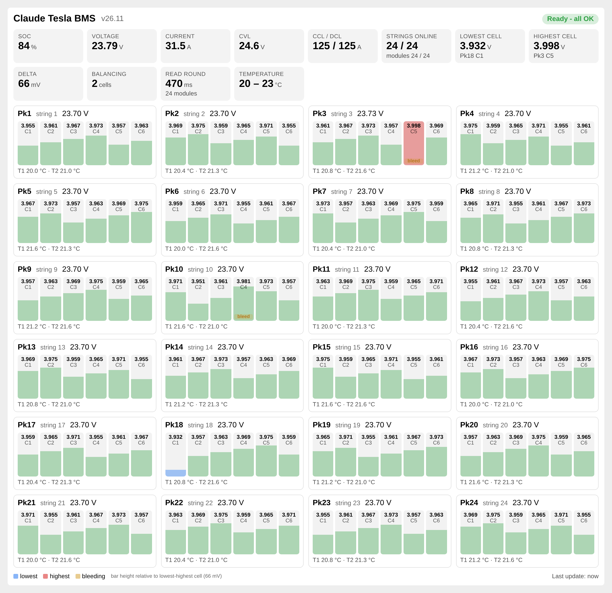

# TeslaBMS_Victron – "Claude Tesla BMS"

A version of [TeslaBMSV2](../TeslaBMSV2.ino) (SimpBMS by Simp ECO Engineering / Tom de Bree)
adapted for **Tesla Model S/X 6S modules on a Victron VenusOS system** (GX device, DVCC, CAN-bus BMS).

The adaptations were written together with Claude (Anthropic) and tested on hardware by [AncoDiara](https://github.com/AncoDiara).
The original TeslaBMSV2 code in this repository is left unchanged.

> **Warning – use at your own risk.** A BMS protects a battery and is safety-critical.
> This version has been tested in a software simulation of the Tesla module chain and on a
> 24 V system with 5–6 modules in parallel. Check all settings and alarms on your own system
> before relying on it, and always use independent protection (fuse, breaker).

Setting up a Windows laptop to always fetch and flash the latest version: see **[WINDOWS-SETUP.md](WINDOWS-SETUP.md)**.

## Hardware

- **Teensy 3.2** on a SimpBMS V2 board, **or** a **Teensy 4.0** on an own board with CAN transceiver
  and the Tesla serial bus (Teensyduino; libraries FlexCAN, FlexCAN_T4 and ADC come with Teensyduino)
- Tesla Model S/X battery modules (6 cells in series, 6S74P)
- Victron GX device (VenusOS) on CAN-bus (VE.Can / BMS-Can, 500 kbit/s)

No external "Filters" library is needed anymore: the low-pass filter for the current measurement is built in (`LowPassFilter.h`).
There are several libraries called "Filters", and installing the wrong one gave the error
`'FilterOnePole' does not name a type`.

## Teensy models: one firmware, hardware differences apart

The same source code runs on every supported Teensy. Only the hardware differs, and that is kept
in two files:

| File | Contents |
|---|---|
| [`board.h`](board.h) | per model: CAN bus, serial port of the Tesla modules, display port, pins of the inputs/outputs |
| [`hal.cpp`](hal.cpp) / [`hal.h`](hal.h) | CAN driver (FlexCAN on 3.2, FlexCAN_T4 on 4.x), watchdog, reset reason, low supply voltage detection |

The compiler chooses the model from the board selected in the Arduino IDE (*Tools → Board*):

| | Teensy 3.2 (SimpBMS V2) | Teensy 4.0 (own board) |
|---|---|---|
| CAN to the GX | Can0, pin 3 TX / 4 RX | CAN1, pin 22 TX / 23 RX (`BMS_CAN_BUS`) |
| Tesla module bus | Serial3, pin 7 RX / 8 TX | Serial2, pin 7 RX / 8 TX (same pins) |
| Display / serial CAN adapter | Serial2, pin 9 / 10 | Serial5, pin 21 RX / 20 TX |
| Inputs IN1–4, outputs OUT1–8 | SimpBMS V2 pins | not present (`PIN_NONE`), fill in `board.h` if your board has them |
| CAN receive buffer | FlexCAN library | 256 messages, filled from the interrupt (nothing lost during the ~0.7 s module read round) |
| Watchdog | WDOG, ~5.5 s | WDOG3, ~5.5 s |
| Save SOC at low supply voltage | yes | no (no such interrupt on the i.MX RT) |
| `hw` in the JSON | `T32` | `T40` |

GitHub Actions builds both from every commit; a release contains `TeslaBMS_Victron-v<x>.hex`
(Teensy 3.2) and `TeslaBMS_Victron_T40-v<x>.hex` (Teensy 4.0), each with a `.sha256`.
The dashboard passes the model of the running Teensy to `teensy_flash.py`, which takes the
matching file and refuses a `.hex` for another model (a Teensy 4 program lives at 0x60000000 and
starts with a FlexSPI boot header).

**Own board with a different wiring?** Change only the block of your Teensy in `board.h`
(CAN bus `CAN1`/`CAN2`/`CAN3`, serial ports, pins). The rest of the code stays the same.

## Topology: strings

Modules are grouped into **strings** (modules in series), and the strings are connected in parallel.

| System | Scells | Modules per string | Pstrings |
|---|---|---|---|
| 24 V | 6 | 1 | number of modules in parallel |
| 48 V | 12 | 2 | number of strings in parallel |

- Addresses are assigned in **order of the communication chain**: address 1..M = string 1, M+1..2M = string 2, etc.
  So wire the comm chain string by string.
- **Auto-detect (default on):** at every start the modules are renumbered in chain order and counted.
  Number of strings = modules found / modules per string (rounded up, so a half 48 V string shows up as offline).
- Switching between 24 V and 48 V: only change Scells (menu `b` → `a`). With auto-detect on, the
  number of strings is recalculated immediately from the modules found (e.g. 6 modules: 6S → 6 strings,
  12S → 3 strings) and the CVL restarts from its new maximum.
- Auto-detect off (menu `m` → `a`): fixed number via menu `b` → `0`. Missing modules then give an alarm already at startup.
- The Tesla comm bus is a daisy chain: if one module board fails, the modules after it are unreachable too.

## Behaviour towards VenusOS

| CAN ID | Content |
|---|---|
| 0x351 | CVL (controlled, see below), CCL, DCL (per string × strings online), discharge voltage |
| 0x355 | SOC, SOH, SOC 0.01 % (fixed: was a factor 10 too low) |
| 0x356 | Pack voltage (average of the complete strings), current, temperature |
| 0x35A | Alarms/warnings, incl. **BMS internal** when a string is missing. Per alarm 2 bits: `10` = OK, `01` = active, `00` = not supported (VenusOS can hide it) High cell voltage: warning at `OverVSetpoint` (4.20 V), alarm at `OverVSetpoint` + 50 mV (4.25 V); a full battery at the charge voltage (4.10 V) gives no warning. |
| 0x35E | `Claude T` (must equal the first 8 characters of 0x370) |
| 0x35F | Firmware version `v<year>.<build>` from `version.h` (e.g. v26.7), capacity in Ah; sent every second |
| 0x370 + 0x371 | Battery name: `Claude Tesla BMS` |
| 0x372 | **Modules** online / offline: the physical number of Tesla modules (24 modules = 24, at 24 V and at 48 V), blocking charge/discharge |
| 0x373 | Min/max cell voltage and temperature |
| 0x374 / 0x375 | **Which cell** has the lowest / highest voltage, e.g. `Pk3 C5` = pack (module) 3, cell 5; sent every second |
| 0x376 / 0x377 | Which temperature sensor is the coldest / warmest, e.g. `Pk2 T1` |
| 0x379 | Installed capacity (Ah per string × number of strings) |

**Missing module/string during operation:** the BMS does *not* go to Error; CVL/CCL/DCL keep being sent.

- immediately: warning "BMS internal"
- after `ModuleAlarmDelay` seconds (default 60): alarm "BMS internal"
- CCL/DCL are scaled with strings online / strings total (can be switched off: menu `m` → `s`)
- every 30 s the missing modules are searched for again; a module that lost its address after a power interruption gets its old address (= the right string) back

## Charge control: CVL, CCL and DCL (Victron style)

**CCL/DCL** are set **per string** (per pack at 24 V):

- default 25 A charge and 25 A discharge per string (menu `e` → `3`, menu `b` → `8`)
- sent to Victron: value per string × number of strings online (with 5 packs: 125 A)
- the CCL is **not** tapered by cell voltage. It only goes to **0 at real overvoltage**:
  highest cell ≥ `OverVSetpoint` (default 4.20 V) – the signal for Victron to switch off all chargers.
  Released when the highest cell is back below 4.15 V.
- fixed: in TeslaBMSV2 the taper could wrap around to a huge CCL (~6500 A), because the current
  was stored as an unsigned number

**CVL** is controlled the way Victron systems expect:

- normal: CVL = `ChargeVsetpoint` × Scells (default 4.10 V × 6 = 24.6 V; storage mode: `StoreVsetpoint`)
- as soon as the highest cell rises above `ChargeVsetpoint`, the CVL is first set to at most battery
  voltage + 0.1 V (a CVL far above the battery voltage limits nothing) and then drops by at most
  **0.1 V per second**, towards *battery voltage − excess of that cell*, so the chargers hold the
  voltage neatly and that cell stays at the target
- when the highest cell is 10–50 mV below the target again, the CVL rises slowly (0.01 V/s);
  more than 50 mV below the target (nowhere near full, or after switching 24 V → 48 V) the CVL goes
  straight to its maximum
- no fixed lower limit: with a badly balanced pack (e.g. five cells at 3.50 V and one at 4.15 V) the CVL
  goes as low as needed; only a safety net against a wrong measurement: `UnderVSetpoint` × Scells
- can be switched off (old behaviour: fixed CVL, CCL taper): menu `m` → `v`
- the status line in the serial monitor shows CVL, CCL and DCL

### CAN protocol: Victron or LG RESU LV (SolarEdge StorEdge RWS)

Menu `m` → `p`, the dashboard (*Maintenance* → *CAN protocol*, double click) or the direct command
`P0` / `P1` choose what the BMS sends on CAN:

- **Victron** (default): 0x351, 0x355, 0x356, 0x35A, 0x35E, 0x35F, 0x370–0x379.
- **LG RESU LV** (for inverters that support the LG Chem RESU 3.3–13 low voltage batteries, e.g.
  SolarEdge StorEdge SE5K–SE10K-RWS, 40–62 V): 0x351, 0x355, 0x356 and 0x359 (warnings in the LG
  layout), CAN 500 kbit/s. Layout from the reverse engineered LG RESU 10 LV
  ([jens18/lgresu](https://github.com/jens18/lgresu)); **not yet verified with a SolarEdge inverter**.
  The lower end of the range (DCL = 0) is at least 41 V for the pack (the RWS stops below 40 V),
  so use 12 cells in series (48 V). Everything the inverter sends is logged (JSON `cx`, max 16
  identifiers, shown in the dashboard) together with its 'keep alive' 0x305 (`ka`).

**CAN speed**: menu, direct command `K250` / `K500` (also `K125`, `K1000`) or the dashboard (*Maintenance* →
*CAN speed*, double click). Choosing the LG RESU protocol sets 500 kbit/s automatically. All devices on a
bus must use the same speed: Victron VE.Can devices (Lynx shunt, MPPTs) are always 250 kbit/s, so a
SolarEdge (500 kbit/s) belongs on the BMS-Can port of the GX (or a VE.Can port set to "CAN-bus BMS 500 kbit/s"),
not on the VE.Can bus with those devices.

Cable GX <-> SolarEdge "Batt. Comm." (not a straight cable!): Victron pin 7 CAN-H -> pin 4, pin 8 CAN-L ->
pin 5, GND -> pin 2 or 6 (selected with the CAN GND switch on the SolarEdge battery board). Terminate only the two
ends of the bus (120 ohm); about 60 ohm between CAN-H and CAN-L with everything off.

**CAN bus health** (JSON `cb`, panel *CAN bus* in the dashboard, both protocols): state of the CAN
controller (OK / error passive / bus off), transmit/receive error counters, messages sent, refused,
received and lost, and the error types of the last 5 s with an explanation (ACK error = nobody
acknowledges: no other device or a different speed; bit/CRC/form/stuff errors = wiring,
termination or speed).

The BMS only allows or blocks charging/discharging (CCL/DCL, CVL); how much power is used is
decided by the inverter (Victron ESS, or SolarEdge storage profile / meter / Modbus remote control).

### Storage mode (input IN1)

The original SimpBMS has a *storage mode*: with input IN1 (key) high the CVL is limited to
`StoreVsetpoint` × Scells (default 3.80 V per cell). Since v26.28 this only works when switched on
in the menu (`m` → `o`, default **off**): on a board where IN1 is not wired, a floating or disturbed
input could otherwise lower the CVL of a full battery to 3.80 V per cell. When it is active, the
JSON field `sm` is 1 and the dashboard shows it in the CVL tile.

### SOC without a current measurement

With the current sensor set to CAN (Lynx/shunt) but no measurement received for 30 s (e.g. a battery on
a SolarEdge inverter without a Lynx on the bus), the coulomb count would freeze. The SOC is then taken
from the **average cell voltage** with the open circuit voltage curve of Tesla NCA cells, scaled to the
working range 3.00 V = 0 % .. 4.10 V = 100 %, low-pass filtered (120 s). JSON `sv` = 1, the dashboard
shows "from cell voltage" in the SOC tile. When current arrives again, the coulomb count continues from
that value. (Menu setting voltsoc = 1 keeps the old configurable line on the lowest cell.)

### SOC from a shunt on the GX (Lynx Smart Shunt, SmartShunt, BMV)

When the battery monitor is connected to the GX instead of the Teensy's CAN bus (e.g. the Teensy's
CAN bus talks to a SolarEdge at 500 kbit/s, the Lynx needs VE.Can at 250 kbit/s), Node-RED sends its
SOC and current to the Teensy every 10 s over USB: direct command `S<soc>,<current A>` (e.g.
`S76.4,-12.4`). The Teensy uses that SOC while it is fresh (< 60 s); the current goes the same way as a
Lynx on the CAN bus (current tile, 0x356). Without it: own SOC (coulomb count or cell voltage).
JSON `sx` = 1, the dashboard shows "from shunt (GX)". Tab variable `TESLABMS_SOC_SOURCE`: `auto`
(first battery service named Lynx / Shunt / BMV, default), `off`, or an exact dbus service name.

### Implausible cell readings

A Tesla CMU of a broken module can report impossible cell voltages (e.g. 5 V). Readings **below 1.0 V
(`IgnoreVolt`, menu) or above 4.5 V** are treated as sensor faults: they are left out of the
lowest/highest cell (so no false over/undervoltage, no CCL/DCL = 0) and out of the average cell voltage.
v26.34 changes an unchanged `IgnoreVolt` of 0.5 V once to 1.0 V. The dashboard shows such cells grey
with "invalid" plus a warning, and the history does not store them.

## Balancing

Passive (bleed resistors in the Tesla module), per string, per cell:

- only cells above **3.90 V** (menu `b` → `5`)
- **start** when a cell is more than **15 mV** above the lowest cell in its string (menu `b` → `l`)
- **stop** when it is only **5 mV** above it (menu `b` → `6`)
- from-voltage, start and stop can also be set from the dashboard (block *Maintenance & updates* →
  *Balancing*), which sends the direct command `B<start>,<stop>,<from mV>` (e.g. `B7,3,3700`; the
  from-voltage needs firmware v26.37, range 3300-4150 mV and below the cell over-voltage setpoint)
  and saves it in the Teensy
- strings cannot balance each other; incomplete strings are not balanced
- the number of balancing cells is now really a count of cells (previously the sum of bitmasks);
  in the pack details a `*` after the voltage shows which cells are being bled

## Detection and communication

- Each reply from a module is checked (address, register, length **and CRC**)
- The receive buffer is flushed before each command (old bytes no longer shift a reply)
- The original minimum wait times are kept: the module needs them to finish an ADC measurement
- `setupBoards()` verifies each newly assigned address and can no longer loop forever

## Node-RED dashboard (USB to the GX)

The Teensy can be connected to a USB port of the GX instead of a laptop. With JSON output on
(menu `m` → `j`) it sends one JSON line every 5 seconds with all cell voltages, balancing, limits and
alarms. The folder [`nodered/`](nodered/) contains a ready-made flow for FlowFuse Dashboard 2.0 that
finds the Teensy port by itself and makes VenusOS serial-starter ignore it (also after a firmware
update). See [nodered/README.md](nodered/README.md).

The dashboard can also **update the Teensy firmware and itself** (buttons in the block *Firmware &
updates*). Every commit is compiled by GitHub Actions with the official Teensy core and published
as a release `fw-v<year>.<build>_flow-v<x>.<y>` with the `.hex`, the Node-RED flow, the Cerbo
scripts and `versions.json`. Firmware and dashboard have separate version numbers, so the dashboard
only offers a firmware update when the firmware itself has changed.

## Serial menu

Open the menu with `s` in the serial monitor (115200 baud).

- `b` – Battery Settings (Scells, Pstrings, capacity **per string**, balancing)
- `m` – **Modules & Strings** (new): overview per string, `a` auto-detect, `f` search again, `r` renumber, `t` alarm delay, `j` JSON output, `v` CVL control, `s` CCL/DCL scaling
- `q` – back / save (EEPROM)

Settings live in the Teensy's EEPROM. On a **Teensy 3.2** that is separate memory and survives
flashing. On a **Teensy 4.0** the EEPROM is emulated in the program flash, and an upload erases
it: after every firmware update the Teensy 4 starts with the defaults (JSON `"er": 1`). The
dashboard remembers the settings of each Teensy (by USB serial number) and sends them back
automatically (cells in series, CAN protocol, CAN speed, balancing), see the Node-RED README.
**Charging in the cold (v26.39).** NCA cells must only be charged slowly below ~10 °C (lithium
plating). The charge current PER STRING follows the coldest temperature sensor, linear between:
`UnderTSetpoint` (−10 °C) 0 A · −5 °C 2.5 A · 0 °C 5 A · 5 °C 12 A · `ChargeTSetpoint` (10 °C) full.
With 12 strings: 30 A at −5 °C, 60 A at 0 °C, 144 A at 5 °C. Discharging is not limited. JSON `"cold": 1`
while the limit is active (shown in the CCL tile). Existing settings: ChargeTSetpoint 0 → 10 °C once.

The JSON output contains the uptime (`up`, seconds) and the reason of the last start (`rr`:
power, pin, watchdog, software, lockup, lowvolt, temp); the dashboard shows both and counts restarts.
Direct command `C<cells>` (e.g. `C12`) sets the cells in series per string (6 = 24 V, 12 = 48 V).
**v26.9 resets them once to the defaults**
(only the CAN speed is kept, so the connection to the GX stays up). Defaults are set for a Victron
system controlled via DVCC: ESS mode on, no charger type (no car-charger messages on CAN),
current from a Victron Lynx/shunt via CAN (PGN 127508), 12 cells per string (48 V; since v26.36), 4.10 V charge voltage,
25 A per string. At startup the serial monitor shows the most important settings, with a warning
when a value is illogical. The charge voltage used by the CVL control is always capped at
`OverVSetpoint` − 50 mV.

## Other fixes compared to TeslaBMSV2

- ESS mode: delay timers for over/undervoltage no longer shared with the charge/discharge logic and no longer inverted
- ESS mode: cell voltage never gives status Error any more (Error set CCL **and** DCL to 0 and opened the
  contactor). Normal range 3.00 – 4.10 V per cell:

  | Lowest / highest cell | CCL | DCL | Message |
  |---|---|---|---|
  | highest ≥ 4.25 V (`OverVSetpoint` + 50 mV) | 0 | normal | alarm high voltage |
  | highest ≥ 4.20 V (`OverVSetpoint`) | 0 | normal | warning high voltage |
  | highest 4.10 V (`ChargeVsetpoint`) | normal (CVL is lowered) | normal | – |
  | lowest 3.30 → 3.00 V (`DischVsetpoint` + `DisTaper`) | normal | tapers to 0 | – |
  | lowest < 2.90 V (`UnderVSetpoint`) | slow (`chargecurrentend`, 2.5 A per string) | 0 | warning low voltage |
  | lowest < 2.85 V | slow | 0 | alarm low voltage |

  CCL = 0 only for a cell that is too high, DCL = 0 only for a cell that is too low (and both for temperature).
  v26.24 changes the old defaults `DischVsetpoint` 3.20 → 3.00 V and `UnderVSetpoint` 3.00 → 2.90 V once,
  only when they were still at the old default.
- Cell count per module is updated regardless of debug output
- "Series Cells Fault" only worked with debug output on; replaced by the string monitoring

Known and not yet fixed: some contactor/precharge timers (`mainconttimer`, `Pretimer`) are not
rollover-safe for `millis()` (after ~49.7 days of continuous operation).

## Version number

`version.h` contains `FW_YEAR` and `FW_BUILD`. VenusOS shows them as e.g. **v26.8** (year.build).
`FW_BUILD` is raised by 1 with every commit that changes the firmware and wraps around after 255.
So every firmware version on GitHub has its own number, whoever compiles it. If you change the
firmware yourself, raise `FW_BUILD` as well. Compile date and time are shown in the serial monitor.

The Node-RED dashboard has its own version: `TESLABMS_FLOW_VERSION` (tab environment variable in
`nodered/tesla-bms-dashboard.json`), raised with every change to the flow. The two numbers do not
have to be equal. The GitHub workflow refuses a push that changes the firmware or the flow without
raising the matching version.

## Licence

Based on TeslaBMSV2, Copyright (c) 2019 Simp ECO Engineering, MIT licence (see the header of
`TeslaBMS_Victron.ino`). The adaptations fall under the same licence.
